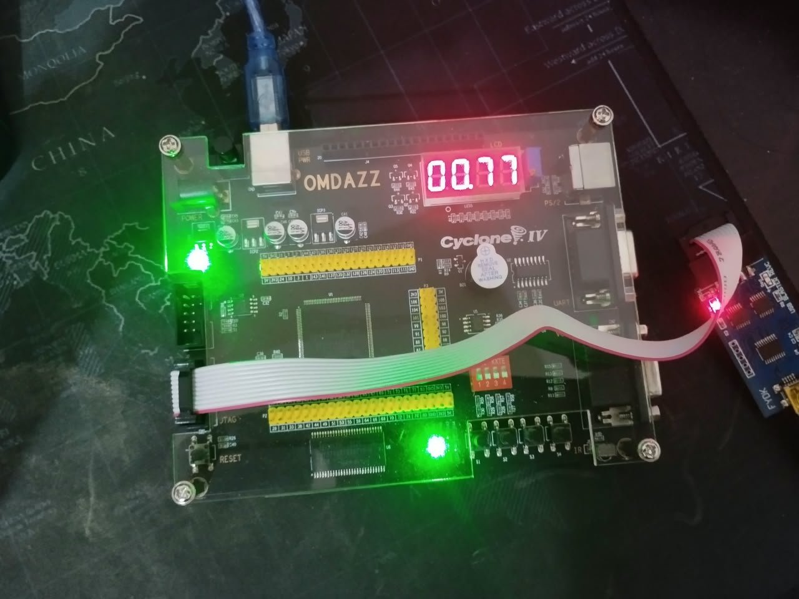

# Akselerator JST INT8 pada FPGA Cyclone IV

Akselerator jaringan saraf tiruan (MLP 196–64–10) berbasis INT8 untuk
mengenali angka tulisan tangan MNIST, berjalan di FPGA Cyclone IV
(papan OMDAZZ, chip EP4CE6E22C8, clock 50 MHz).

Repository ini memuat seluruh alur: pelatihan dan kuantisasi model di PC,
pemetaan bobot ke memori M9K, rancangan Verilog beserta simulasinya, sampai
proyek Quartus untuk memprogram papan.

Selain rancangan utama *output-stationary* (OS), repository ini memuat dua
rancangan pembanding dengan model, chip, clock, dan unit MAC yang sama, yaitu
*weight-stationary* (WS) dan *no local reuse* (NLR, tanpa stationary), serta
pembanding inferensi di CPU laptop. Ketiganya dibandingkan dari sisi waktu,
daya, dan energi per citra.

```
Alur_Utama/
├── 1_Python_PC/     langkah 1–4  model, bobot .hex, citra uji, golden
├── 2_Verilog/       langkah 5–6  rancangan akselerator OS + simulasi
├── 3_Quartus/       langkah 7–9  kompilasi, program papan (OS)
├── 4_WS/            rancangan weight-stationary (larik sistolik 4 × 2, batch 16)
├── 5_PC/            pembanding CPU: model INT8 dan FP32, waktu, daya
├── 6_Daya_FPGA/     analisis daya OS dengan Power Analyzer
├── 7_NLR/           rancangan no local reuse (tanpa stationary)
└── gambar/          foto papan untuk README
```

---

## Ringkasan rancangan utama (OS)

| | |
|---|---|
| Model | MLP 196–64–10, aktivasi ReLU; citra MNIST 28×28 dirata-rata blok 2×2 menjadi 14×14 |
| Format bilangan | input Q2.6, bobot Q3.5, bias Q1.7, aktivasi Q5.3, akumulator 32 bit |
| Parameter | 13.258 = 13.184 bobot (di M9K) + 74 bias (ROM `rom_bias8.v`) |
| Paralelisme | 8 lajur MAC; satu piksel disiarkan ke 8 lajur sekaligus |
| Dataflow | *Output-stationary* (varian OS_C untuk lapisan FC): jumlah parsial diam di akumulator tiap lajur sampai neuron selesai; hasil 8 lajur diambil serentak ke register penangkap lalu dikuras sambil aliran berikutnya berjalan |
| Memori bobot | 8 bank M9K; bank *j* berisi neuron *j*, *j*+8, *j*+16, …; satu pencacah alamat untuk semua bank |

## Hasil rancangan utama (OS)

| Pengukuran | Hasil |
|---|---|
| Akurasi | FP32 97,45 %, INT8 97,45 % |
| Siklus per inferensi | 1.708 siklus = 34,16 µs pada 50 MHz (isi pipa awal: 2, lapisan 1: 1.568, lapisan 2: 128, ekor pipa dan pengurasan kelompok terakhir: 10); utilisasi MAC 99,3 % |
| Pemakaian chip | 2.306 / 6.272 LE (37 %), 1.420 register, 21 / 30 M9K, 143.392 / 276.480 bit memori (52 %), 8 / 30 pengali 9 bit, 21 / 92 pin |
| Timing | Fmax 82,46 MHz (slack setup 7,873 ns pada periode 20 ns) |
| Daya (perkiraan Power Analyzer) | 93,91 mW saat bekerja, 3,208 µJ per citra, confidence High |
| Simulasi RTL | LULUS: 18 inferensi, kesepuluh akumulator keluaran tiap citra identik dengan acuan Python |
| Uji papan | 16 / 16 citra uji cocok dengan tebakan Python |

## Perbandingan OS, WS, NLR, dan PC

| | OS | WS (4 × 2, batch 16) | NLR (tanpa stationary) | PC INT8 (1 inti Ryzen 5 7535HS) |
|---|---|---|---|---|
| Yang ditahan di dekat MAC | jumlah parsial | bobot | tidak ada | – |
| Siklus per citra | 1.708 | 1.649 | 1.965 | – |
| Waktu per citra | 34,16 µs | 32,98 µs | 39,30 µs | 16,11 µs (1 ÷ 62.058 citra/s) |
| Latensi sampai hasil pertama | 34,16 µs | 527,66 µs | 39,30 µs | median 15,6 µs |
| Logic element | 2.306 | 3.573 | 2.317 | – |
| Blok M9K | 21 / 30 | 22 / 30 | 29 / 30 | – |
| Fmax | 82,46 MHz | 88,55 MHz | 73,61 MHz | – |
| Daya saat bekerja | 93,91 mW | 108,63 mW | 118,17 mW | 24,79 W (paket CPU) |
| **Energi per citra** | **3,208 µJ** | **3,582 µJ** | **4,644 µJ** | **399,5 µJ** |

- Waktu per citra = siklus ÷ 50 MHz. Energi per citra = daya saat bekerja ×
  waktu per citra.
- Daya FPGA adalah perkiraan Power Analyzer Quartus (confidence High) dari
  simulasi netlist; daya PC adalah telemetri CPU (HWiNFO). Keduanya bukan
  pengukuran arus fisik.
- Ketiga rancangan FPGA lulus simulasi RTL dan uji papan dengan keluaran
  identik dengan acuan Python, dan memakai `mac_unit.v` yang sama tanpa
  diubah.

**Ringkasan:** OS paling hemat energi. WS mengurangi akses memori (energi M9K
4× lebih kecil), tetapi register untuk jumlah parsial dan argmax 16 citra
membuat energi totalnya sekitar 12 % lebih besar, dan latensinya menunggu satu
batch. NLR paling boros dan paling lambat karena setiap jumlah parsial dibaca
dan ditulis ke M9K pada setiap operasi. Dibanding satu inti CPU, ketiganya
sekitar 2–2,4× lebih lambat, tetapi 86–125× lebih hemat energi per citra.

---

## Kebutuhan

| Untuk | Perangkat |
|---|---|
| Simulasi | Python 3 (tanpa paket tambahan) dan [Icarus Verilog](https://bleyer.org/icarus/) |
| Kompilasi dan program papan | Quartus Prime Lite 25.1std, papan OMDAZZ Cyclone IV (EP4CE6E22C8), USB-Blaster |
| Notebook pelatihan (opsional) | Python 3 dengan PyTorch, torchvision, numpy |

---

## 1_Python_PC

| Langkah | Berkas | Hasil |
|---|---|---|
| 1–3 Training dan kuantisasi INT8 | `Training/Training_MLP_PyTorch.ipynb`, Tahap 1–6 | `Training/export_final/` (model beku, akurasi 97,45 %) |
| 4a Bobot ke format memori FPGA | `Training/Training_MLP_PyTorch.ipynb`, Tahap 7 | `mem/P8/mem_w_b0..b7.hex` (8 bank), `mem/mem_d.hex`, `mem/rom_bias8.v` |
| 4b 16 citra uji, golden, dan ROM citra | `Training/Training_MLP_PyTorch.ipynb`, Tahap 8 | `uji/citra_00..15.hex`, `uji/golden_uji.txt`, `uji/daftar_uji.txt`, `uji/citra_papan.hex` |

**Semua hasil sudah tersedia dan tidak perlu dibuat ulang.** Tahap 1–6 notebook
sengaja tidak dijalankan lagi: hasil pelatihan ulang tidak akan sama persis,
sehingga seluruh pengujian harus diulang. Tahap 7 dan Tahap 8 notebook
aman dijalankan; keluarannya identik dengan berkas yang ada (sudah diuji).
Aturan lengkapnya ada di `Training/export_final/MANIFEST.md`
(di sana folder Verilog disebut `rtl/`; di repository ini namanya `2_Verilog/`).

`rom_bias8.v` berbentuk Verilog, tetapi tempatnya di sini karena dibuat oleh
Tahap 7 notebook dari bias model.

**Data MNIST.** Sumber: LeCun, Cortes, dan Burges, *The MNIST Database of
Handwritten Digits*. `Training/data/MNIST/raw/` hanya berisi test set
(10.000 citra) karena dibaca langsung oleh Tahap 8. Training set tidak
disertakan; notebook mengunduhnya otomatis bila Tahap 1–6 dijalankan.

---

## 2_Verilog

| Berkas | Fungsi |
|---|---|
| `top_papan.v` | **rancangan teratas**: akselerator + ROM 16 citra + tombol + seven-segment + LED |
| `ctrl_fsm_p8.v` | pengendali orkestrasi memori, 8 lajur |
| `mem_w.v`, `mem_d.v` | memori bobot dan memori data (M9K) |
| `mac_unit.v` | unit MAC: pipa 2 tahap, handshake valid/ready, akumulator 32 bit |
| `mult_hard8.v` | pengali 9 bit bawaan chip, **yang dipakai** |
| `mult_bw8_arith.v`, `mult_bw8_struct.v` | varian pengali lain; tetap disertakan karena dirujuk `mac_unit.v` |
| `epilog_unit.v` | geser bit, ReLU |
| `argmax10.v` | memilih angka dengan nilai terbesar |
| `seg7_scan.v`, `seg7_dec.v` | penggerak seven-segment |
| `papan.sdc` | batasan clock 50 MHz |
| `tb_papan.v` + `jalankan_papan.py` | simulasi sebelum masuk chip |

**Menjalankan simulasi:** klik dua kali `JALANKAN_SIMULASI.bat`. Berkas ini
mencari Icarus Verilog dan Python sendiri. Cara lain, dari folder `2_Verilog`:

```
python jalankan_papan.py
```

Harus berakhir dengan `HASIL: LULUS — 18 inferensi`.

---

## 3_Quartus

| Berkas | Fungsi |
|---|---|
| `papan.qpf`, `papan.qsf` | proyek Quartus: chip EP4CE6E22C8, daftar berkas, pin papan |
| `JALANKAN_PAPAN.bat` | langkah 1 kompilasi, langkah 2 program papan lewat USB-Blaster |
| `output_papan/papan.sof` | hasil kompilasi yang siap diprogram |
| `output_papan/papan.fit.summary` | pemakaian LE, memori, pengali |
| `output_papan/papan.sta.summary` | hasil analisis timing (Fmax) |

Klik dua kali `JALANKAN_PAPAN.bat` (tutup Quartus GUI dulu). Kalau hanya
ingin memprogram tanpa kompilasi ulang: Quartus Programmer → Add File →
`output_papan/papan.sof` → Start.

Di papan, layar menampilkan `[nomor citra][.][tebakan Python][tebakan FPGA]`,
misalnya `00.77`. LED1 menyala bila keduanya cocok. S1 citra berikutnya,
S2 sebelumnya, S3 ulang, S4 ditahan menampilkan jumlah siklus (1708).



*Papan menampilkan `00.77`: citra uji nomor 00, tebakan Python 7, tebakan
FPGA 7.*

---

## 4_WS

Rancangan *weight-stationary*: larik sistolik 4 × 2, bobot dimuat sekali lalu
dipakai untuk 16 citra (batch 16). Modul bersama (`mac_unit.v`, pengali,
`mem_w.v`, `epilog_unit.v`, `rom_bias8.v`, penggerak seven-segment) dirujuk
dari `2_Verilog/` dan `1_Python_PC/mem/` tanpa diubah.

| Berkas / folder | Isi |
|---|---|
| `SPESIFIKASI_WS.md` | rancangan WS, jadwal larik, dan alasan pemilihan batch |
| `PERBANDINGAN_OS_WS.md` | perbandingan OS vs WS: waktu, akses memori, daya, energi |
| `1_mem/` | `gen_mem_ws.py` (8 bank bobot WS dan ROM citra 32 bit), `model_ws.py` (acuan) |
| `2_verilog/` | `top_papan_ws.v`, `ctrl_ws.v`, `larik_ws.v`, `buf_aktivasi_ws.v`, `argmax_batch.v`, testbench; simulasi: `JALANKAN_SIMULASI_WS.bat` |
| `3_quartus/` | proyek papan WS; `JALANKAN_PAPAN_WS.bat`, `output_papan_ws/papan_ws.sof` |
| `4_daya/` | analisis daya WS; `JALANKAN_DAYA_WS.bat` |

Simulasi harus berakhir dengan `HASIL: LULUS` (16 citra satu batch, 26.383
siklus = 1.649 siklus per citra).

---

## 5_PC

Model yang **sama** dijalankan di CPU laptop (AMD Ryzen 5 7535HS, satu inti):
INT8 dengan NumPy (aritmetika persis seperti FPGA) dan FP32 dengan PyTorch.
Berisi skrip kebenaran model, metrik akurasi (precision, recall, F1),
pengukuran latensi dan throughput, serta pengolahan log daya HWiNFO. Cara
menjalankan dan hasil lengkap ada di `5_PC/README.md`.

---

## 6_Daya_FPGA

Perkiraan daya rancangan OS dengan Power Analyzer Quartus. Aktivitas sinyal
diambil dari simulasi netlist pascasintesis, dipotong tepat pada jendela
inferensi (1.708 siklus) dan pada jendela chip diam dengan panjang yang sama.
Jalankan `JALANKAN_DAYA_OS.bat` (sekitar 1 menit, tanpa papan). Metode dan
hasil ada di `6_Daya_FPGA/README.md`.

---

## 7_NLR

Rancangan *no local reuse* (NLR), disebut juga tanpa stationary (Sze dkk.,
2017): tidak ada data yang ditahan di MAC. Setiap jumlah parsial dibaca dari
memori M9K, ditambah, lalu ditulis kembali pada setiap operasi. Bank bobot,
unit MAC, epilog, argmax, dan pembungkus papan sama dengan OS; yang berbeda
hanya pengendali dan memori jumlah parsial.

| Berkas / folder | Isi |
|---|---|
| `SPESIFIKASI_NLR.md` | definisi, arsitektur, jarak aman baca-setelah-tulis (K = 5), hasil |
| `2_verilog/` | `ctrl_nlr.v`, `mem_psum.v` (8 blok M9K jumlah parsial), `top_papan_nlr.v`, `tb_papan_nlr.v`, `jalankan_papan_nlr.py` |
| `3_quartus/` | proyek papan NLR; `JALANKAN_PAPAN_NLR.bat`, `output_papan_nlr/papan_nlr.sof` |
| `4_daya/` | analisis daya NLR (jendela bekerja dan diam); `JALANKAN_DAYA_NLR.bat` |

Menjalankan simulasi, dari folder `7_NLR/2_verilog`:

```
python jalankan_papan_nlr.py
```

Harus berakhir dengan `HASIL: LULUS — 18 inferensi` dan tepat 1.965 siklus
per inferensi.

---

## Pembagian proyek

Proyek skripsi kolaboratif, Teknik Komputer, FILKOM Universitas Brawijaya.

| Bagian | Cakupan | Mahasiswa |
|---|---|---|
| Student A | unit MAC | Laksana Aura Ibrahim |
| Student B | orkestrasi memori dan pengendali (OS, WS, NLR), analisis daya, pembanding PC | Rifan Januar Rifa'i |
| Student C | pelatihan dan pemetaan model INT8 | Rifan Januar Rifa'i |

Dosen pembimbing: Agung Setia Budi, S.T., M.T., M.Eng., Ph.D.

## Lisensi

Kode dan dokumentasi di repository ini memakai lisensi [MIT](LICENSE).

Pengecualian: berkas data MNIST di `1_Python_PC/Training/data/MNIST/raw/`
bukan karya repository ini dan tetap mengikuti lisensi sumbernya
(Creative Commons Attribution-Share Alike 3.0).
