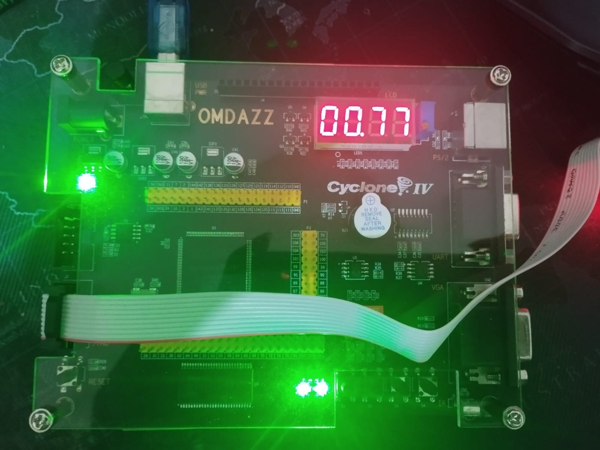

# Akselerator JST INT8 pada FPGA Cyclone IV

Akselerator jaringan saraf tiruan (MLP 196–64–10) berbasis INT8 untuk
mengenali angka tulisan tangan MNIST, berjalan di FPGA Cyclone IV
(papan OMDAZZ, chip EP4CE6E22C8, clock 50 MHz).

Repository ini memuat seluruh alur: pelatihan dan kuantisasi model di PC,
pemetaan bobot ke memori M9K, rancangan Verilog beserta simulasinya, sampai
proyek Quartus untuk memprogram papan.



*Papan menampilkan `00.77`: citra uji nomor 00, tebakan Python 7, tebakan
FPGA 7. Cara membaca tampilan ada di bagian [3_Quartus](#3_quartus).*

```
Alur_Utama/
├── 1_Python_PC/     langkah 1–4  model, bobot .hex, citra uji, golden
├── 2_Verilog/       langkah 5–6  rancangan akselerator + simulasi
├── 3_Quartus/       langkah 7–9  kompilasi, program papan
└── gambar/          foto papan untuk README
```

---

## Ringkasan rancangan

| | |
|---|---|
| Model | MLP 196–64–10, aktivasi ReLU; citra MNIST 28×28 dirata-rata blok 2×2 menjadi 14×14 |
| Format bilangan | input Q2.6, bobot Q3.5, bias Q1.7, aktivasi Q5.3, akumulator 32 bit |
| Parameter | 13.258 = 13.184 bobot (di M9K) + 74 bias (ROM `rom_bias8.v`) |
| Paralelisme | 8 lajur MAC; satu piksel disiarkan ke 8 lajur sekaligus |
| Memori bobot | 8 bank M9K; bank *j* berisi neuron *j*, *j*+8, *j*+16, …; satu pencacah alamat untuk semua bank |

## Hasil

| Pengukuran | Hasil |
|---|---|
| Akurasi | FP32 97,45 %, INT8 97,45 % |
| Siklus per inferensi | 1.816 siklus = 36,32 µs pada 50 MHz (lapisan 1: 1.568, lapisan 2: 128, pengurasan: 80, jeda/transisi: 40) |
| Pemakaian chip | 2.129 / 6.272 LE (34 %), 1.185 register, 17 / 30 M9K, 143.392 / 276.480 bit memori (52 %), 8 / 30 pengali 9 bit, 21 / 92 pin |
| Timing | Fmax 70,58 MHz (slack setup 5,832 ns pada periode 20 ns) |
| Simulasi RTL | LULUS: 18 inferensi, identik dengan acuan Python |
| Uji papan | 16 / 16 citra uji cocok dengan tebakan Python |

---

## Kebutuhan

| Untuk | Perangkat |
|---|---|
| Simulasi | Python 3 (tanpa paket tambahan) dan [Icarus Verilog](https://bleyer.org/icarus/) |
| Kompilasi dan program papan | Quartus Prime Lite 25.1std, papan OMDAZZ Cyclone IV (EP4CE6E22C8), USB-Blaster |
| Notebook pelatihan (opsional) | Python 3 dengan PyTorch, torchvision, numpy |

---

## 1_Python_PC

| Langkah | Berkas | Hasil |
|---|---|---|
| 1–3 Training dan kuantisasi INT8 | `Training/Training_MLP_PyTorch.ipynb`, Tahap 1–6 | `Training/export_final/` (model beku, akurasi 97,45 %) |
| 4a Bobot ke format memori FPGA | `Training/Training_MLP_PyTorch.ipynb`, Tahap 7 | `mem/P8/mem_w_b0..b7.hex` (8 bank), `mem/mem_d.hex`, `mem/rom_bias8.v` |
| 4b 16 citra uji, golden, dan ROM citra | `Training/Training_MLP_PyTorch.ipynb`, Tahap 8 | `uji/citra_00..15.hex`, `uji/golden_uji.txt`, `uji/daftar_uji.txt`, `uji/citra_papan.hex` |

**Semua hasil sudah tersedia dan tidak perlu dibuat ulang.** Tahap 1–6 notebook
sengaja tidak dijalankan lagi: hasil pelatihan ulang tidak akan sama persis,
sehingga seluruh pengujian harus diulang. Tahap 7 dan Tahap 8 notebook
aman dijalankan; keluarannya identik dengan berkas yang ada (sudah diuji).
Aturan lengkapnya ada di `Training/export_final/MANIFEST.md`
(di sana folder Verilog disebut `rtl/`; di repository ini namanya `2_Verilog/`).

`rom_bias8.v` berbentuk Verilog, tetapi tempatnya di sini karena dibuat oleh
Tahap 7 notebook dari bias model.

**Data MNIST.** Sumber: LeCun, Cortes, dan Burges, *The MNIST Database of
Handwritten Digits*. `Training/data/MNIST/raw/` hanya berisi test set
(10.000 citra) karena dibaca langsung oleh Tahap 8. Training set tidak
disertakan; notebook mengunduhnya otomatis bila Tahap 1–6 dijalankan.

---

## 2_Verilog

| Berkas | Fungsi |
|---|---|
| `top_papan.v` | **rancangan teratas**: akselerator + ROM 16 citra + tombol + seven-segment + LED |
| `ctrl_fsm_p8.v` | pengendali orkestrasi memori, 8 lajur |
| `mem_w.v`, `mem_d.v` | memori bobot dan memori data (M9K) |
| `mac_unit.v` | unit MAC: pipa 2 tahap, handshake valid/ready, akumulator 32 bit |
| `mult_hard8.v` | pengali 9 bit bawaan chip, **yang dipakai** |
| `mult_bw8_arith.v`, `mult_bw8_struct.v` | varian pengali lain; tetap disertakan karena dirujuk `mac_unit.v` |
| `epilog_unit.v` | geser bit, ReLU |
| `argmax10.v` | memilih angka dengan nilai terbesar |
| `seg7_scan.v`, `seg7_dec.v` | penggerak seven-segment |
| `papan.sdc` | batasan clock 50 MHz |
| `tb_papan.v` + `jalankan_papan.py` | simulasi sebelum masuk chip |

**Menjalankan simulasi:** klik dua kali `JALANKAN_SIMULASI.bat`. Berkas ini
mencari Icarus Verilog dan Python sendiri. Cara lain, dari folder `2_Verilog`:

```
python jalankan_papan.py
```

Harus berakhir dengan `HASIL: LULUS — 18 inferensi`.

---

## 3_Quartus

| Berkas | Fungsi |
|---|---|
| `papan.qpf`, `papan.qsf` | proyek Quartus: chip EP4CE6E22C8, daftar berkas, pin papan |
| `JALANKAN_PAPAN.bat` | langkah 1 kompilasi, langkah 2 program papan lewat USB-Blaster |
| `output_papan/papan.sof` | hasil kompilasi yang siap diprogram |
| `output_papan/papan.fit.summary` | pemakaian LE, memori, pengali |
| `output_papan/papan.sta.summary` | hasil analisis timing (Fmax) |

Klik dua kali `JALANKAN_PAPAN.bat` (tutup Quartus GUI dulu). Kalau hanya
ingin memprogram tanpa kompilasi ulang: Quartus Programmer → Add File →
`output_papan/papan.sof` → Start.

Di papan, layar menampilkan `[nomor citra][.][tebakan Python][tebakan FPGA]`,
misalnya `00.77`. LED1 menyala bila keduanya cocok. S1 citra berikutnya,
S2 sebelumnya, S3 ulang, S4 ditahan menampilkan jumlah siklus (1816).

---

## Pembagian proyek

Proyek skripsi kolaboratif, Teknik Komputer, FILKOM Universitas Brawijaya.

| Bagian | Cakupan | Mahasiswa |
|---|---|---|
| Student A | unit MAC | Laksana Aura Ibrahim |
| Student B | orkestrasi memori dan pengendali | Rifan Januar Rifa'i |
| Student C | pelatihan dan pemetaan model INT8 | Rifan Januar Rifa'i |

Dosen pembimbing: Agung Setia Budi, S.T., M.T., M.Eng., Ph.D.

## Lisensi

Kode dan dokumentasi di repository ini memakai lisensi [MIT](LICENSE).

Pengecualian: berkas data MNIST di `1_Python_PC/Training/data/MNIST/raw/`
bukan karya repository ini dan tetap mengikuti lisensi sumbernya
(Creative Commons Attribution-Share Alike 3.0).
